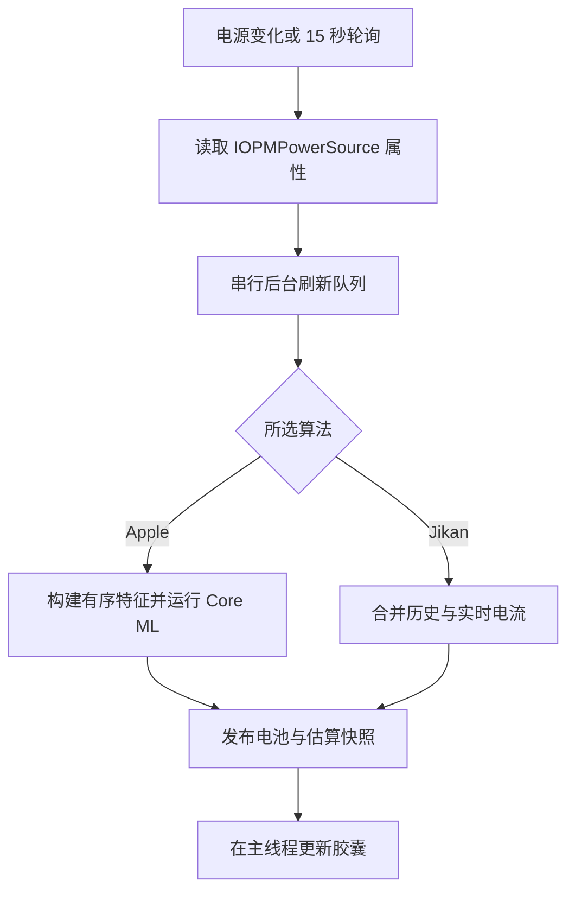

# Jikan 如何估算充电时间

> 本文档翻译自英文原版，如有歧义以原文为准。

Jikan 有两种充电时间算法：Apple——初始默认项，并在实测输入确认后成为推荐选择；以及 Jikan——基于充电历史与电池电流的自研估算器。在没有已确认 Apple 支持的设备上，持续的输入失败可以把自动默认项改为 Jikan。两者都在本地运行，预测达到所选百分比需要多久；都不控制充电，也不改变手机的充电上限。ChargeLimiter 集成只是把目标复制进 Jikan 的偏好设置。

本指南覆盖当前实现、2026 年 9 月 23–24 日针对 iOS 26.0 的调查，以及随后的集成工作。文中对 Apple 内部机制的描述适用于被检视的二进制与捕获的会话；它们并不能证明每个 iOS 版本或每台设备的行为皆是如此。

## 两种算法

| | Jikan 中的 Apple 算法 | Jikan 算法 |
| --- | --- | --- |
| 方法 | 使用重建的 Apple 模型资产做本地 Core ML 推理 | 记录每个百分点所需时长，辅以实时电池电流 |
| 目标 | 80%、85%、90%、95%、100% | 1% 到 100% 的任意整数百分比 |
| 历史 | 固定模型权重；变化的遥测与会话输入 | 在本设备上收集的充电历史 |
| 主要要求 | 兼容的模型文件与所需的电池遥测 | 可用的历史，或足以填补缺失区间的容量/电流数据 |
| 更新 | 手动替换模型资产与配套集成代码 | 统计数据随 Jikan 观测充电而累积 |

在 Apple 模式下，Jikan 自己收集输入并运行打包的模型，不调用 Apple 的电池智能服务。这些模型在被测的 iOS 16.3.1 设备和 iOS 26.0 上均可运行。如果 Apple 预测不可用，Jikan 保持所选算法不变。

### 共享可用性与可选的估算输入功率

SpringBoard 使用估算器的电池读数与经过校验的实测辅助功率来评估 Apple 输入可用性，然后把结果发布给设置面板。设置面板不做自己的 IORegistry 查询。该评估使用相关的 Apple 目标——即便当前激活的算法是 Jikan 也是如此——因此在自动回退之后仍能发现已恢复的实测输入。

未经测试的目标保持未知状态，默认选择 Apple 且不带推荐标记。在某个目标没有已确认实测成功的设备上，自动默认项只有在出现至少三次一致的、新鲜的输入失败、且跨越 30 秒有效充电之后，才会变为 Jikan。未插电、已暂停、初始化中、目标已完成、模型加载中以及辅助进程传输中的状态都不构成硬件支持缺失。一次被确认的原生或实测辅助成功会按目标与系统/内核环境被记住；之后的读数缺失会让 Apple 仍保持推荐，并可能使其估算暂时不可用。共享状态记录确切的失败原因与缺失字段。缓存的近似预测不算作新鲜的输入检查。

显式选择 Apple 或 Jikan 优先于自动推荐。在已确认实测支持或可用性未知的情况下选择 Apple，不会启用未经实测的功率。只有当推荐基于「已确认输入缺失」时，选择 Apple 才会触发原有的预估功率警告；点「继续（Proceed）」即显式启用基于适配器的近似。没有额外的开关。已有的许可会被保留；选择 Jikan 或重置偏好设置会撤销它。重置偏好设置会保留实测能力证据。

启用后，Jikan 仍优先使用原生或经过校验的实测输入功率。只有当这些都缺失、且充电器被识别为有线连接时，才使用适配器标称的 `Watts`（或 `AdapterVoltage × Current`）作为**猜测的** SystemPowerIn 值。适配器标称值是功率*能力*，不是瞬时 USB 功率。实际取用功率——尤其在充电末端降流（taper）或接近充满时——可能远低于标称值。这类 Apple 时间估算在锁屏上标注 **≈**，诊断中报告的来源为 `adapter_estimate`。该可选项绝不会绕过缺失的电池特征、无效的原生数值、断开/暂停状态或不兼容的模型文件。此回退的真机测试与真实充电会话下的准确性仍未验证。

## 从电池读数到锁屏



[`TT100.m`](../Tweak/TT100/TT100.m) 使用 `IOServiceMatching("IOPMPowerSource")` 与 `IORegistryEntryCreateCFProperties` 读取电池服务。它监听电源通知并每 15 秒轮询一次，定时器容差为一秒。相关 UI 或偏好设置的更改也会触发刷新。昂贵的工作在串行队列上执行。代（generation）检查会在工作运行期间 Jikan 被禁用或其偏好发生变化时丢弃结果。

快照包含估算字符串、可用性与状态、所选算法、目标、电池属性，以及目标是否已达成。[`Jikan.x`](../Tweak/Jikan.x) 用它更新锁屏。胶囊需要外部供电，且通常需要可用的估算。在 Apple 模式下，若初始等待后预测仍不可用，胶囊仍可带着如实的 N/A 出现；这并不会悄悄切换到 Jikan 算法。可选的充满后显示可以表明目标已达成。Show Preview 显示示例文字，不会创建真实估算。当 Apple 特征校验返回 `missing_required_feature` 时，`moe.waru.jikan.estimate-status.plist` 会包含 `latest.missingFeatures`，其中只有缺失/无效的输入键名（不含原始电池读数）。

在 iOS 16 或更高版本上，Use Date Row Instead 会在放得下时把估算放进日期行。本地化文字包含所选目标，例如 `27m to 80%` 或 `1h 23m to 100%`，使用任一算法给出的数值化剩余时长。预览使用相同格式与所选目标。胶囊保持两行文案。

当存在内联小组件时，Jikan 在其原生快照中测量可见内容，并将其与估算一起居中，中间留出固定间隙。小组件的完整原生画布与日期格式保持不变。合并后的行最多可缩小到 80%。如果 Jikan 无法确定内容边界，或空间仍然不足，就回退到胶囊。原生内容或外观的变化会触发异步测量更新。

Show Preview 跟随所选显示模式；若日期行放不下估算，则使用同样的胶囊回退。

## Jikan 算法的工作原理

### 学习充电时长

Jikan 把充电会话与百分比跳变记录在本地 SQLite 数据库中：进程用户主目录下的 `Library/TT100/tt100.db`。统计按充电器类别分组，区分有线与无线充电以及不同的功率档位。充电器身份变化会结束一条会话并开始另一条。

当电池在两次观测之间前进了多个百分点时，Jikan 把流逝时间平均分摊到这些跳变上。显式的充电暂停会重置计时基线，因此暂停时长不会计入下一条记录的充电区间。

[`TT100Database.m`](../Tweak/TT100/TT100Database.m) 存储样本数、均值、方差，以及分批的中位数与离散度。估算器优先使用有效的累积均值，出于兼容性回退到存储的中位数。它也会读取不确定度与数据年龄，但目前不会用它们对历史桶加权或剔除。

### 估算剩余区间

对当前电量与目标之间的每个百分比区间，Jikan 按以下优先级选择一个时长：

1. 使用检测到的充电器类别的已记录统计。
2. 若该类别没有记录统计，尝试 `unknown` 类别。
3. 若两次数据库查询都拿不到历史，尝试旧版历史读取器。
4. 用实时电池容量与电流填补缺失或不可用的百分比区间。

旧版读取器在探测到的 `CurrentPowerlog.PLSQL` 路径中查找文本形式的 `INSERT INTO battery_history ...` 记录。它不是通用的 Powerlog 数据库解码器，不一定能在每台设备上找到可用历史。

实时回退的计算方式：

```text
seconds per percentage point =
    ((raw maximum capacity − raw current capacity) / (100 − current percentage))
    / battery current in mA × 3600

remaining seconds = sum(duration for each remaining percentage interval)
```

容量单位是 mAh。若原始容量不可用，代码用设计容量与显示的电量百分比来近似它。优先取 `InstantAmperage` 的绝对值，必要时回退到 `Amperage`。第一个部分完成的百分比区间只贡献其剩余比例。

每个剩余区间都需要可用的时长。如果历史和实时电流都覆盖不了某个区间，估算即不可用。

这种方式支持任意目标，并能学习手机的充电模式。瞬时充电速率无法顾及未来的降流、温控限制或用机习惯变化。历史稀疏时，估算会更多地依赖这种近似。

## Apple 的 iOS 26 实现原理

Apple 在 iOS 26 的「设置 → 电池」与锁屏中提供充电时间估算：预测到达 80%，或到达充满/80% 以上所配置充电上限的时间。[Apple 的充电速度指南](https://support.apple.com/en-ie/120619)描述了该功能。以下内部细节来自真机调查。

### 从设置到估算器

被检视的 `BatteryUsageUI.bundle/BatteryUsageUI` 二进制使用来自 `BatteryIntelligence.framework` 的 `BIBatteryAnalysisClient`。该客户端通过其 battery-analysis XPC 服务与 `/usr/libexec/batteryintelligenced` 通信。

观察到的目标有：

- **TT80**，目标 0：到达 80% 的时间。
- **TTL**，目标 1：到达充电上限的时间。被检视的 TTL 特征校验路径接受 85%、90%、95% 与 100%。

独立客户端需要 `com.apple.batteryintelligenced.batteryanalysis-read` 权限（entitlement）才能获得实时结果；没有它，调用会失败。响应中包含秒数、结束百分比、预测时刻的电量百分比、置信度及其他状态信息。一次成功的缓存调用仍可能返回不可用或为零的估算，因此除了调用是否成功，还必须检查响应本身。

### 模型选择与会话计时

守护进程用 Apple 的 Trial 配置挑选受支持的模型版本，然后加载其编译后的 bundle。在被测设备上观察到的激活版本：

| 目标 | 原机资产 | 输入 | 输出 |
| --- | --- | --- | --- |
| TT80 | `/usr/libexec/battery_analysis_tt80_model_bkwqiw7f79.mlmodelc` | Float32 `[1, 25]`，名为 `input_1` | `tt80_prediction` |
| TTL | `/usr/libexec/battery_analysis_ttl_model_k5wmzvi5mm.mlmodelc` | Float32 `[1, 29]`，名为 `input_1` | `ttl_prediction` |

文件打开追踪确认，Trial 选中并激活的 TTL 版本与守护进程的回退版本不同。在设备上找到某个模型 bundle 并不足以确定当前激活的模型。

被检视的管理器使用 `CLOCK_MONOTONIC_RAW` 记录插电时间，并通过 `IOPSGetPercentRemaining` 获取起始电量百分比。它在连接约四秒后安排一次预测任务，并在一次充电预测任务结束后再设置一个 300 秒的闹钟。

模型网络输出的是小时数。观察到的后处理为：

```text
TT80 seconds = model output × 3600
TTL seconds  = model output × 3600 + 300
```

调查确认了 TTL 中多出的五分钟，但未能查明 Apple 为何加上它。服务为每条预测存储一个单调时间戳，并在之后返回实时结果时扣除已流逝的时间。对比不同时刻的读数时需要考虑这一倒计时。

## 重建模型输入

要以正确的输入运行 `.mlmodelc`，需要还原守护进程的特征顺序、单位与会话值。

[`JikanAppleFeatures.m`](../Shared/JikanAppleFeatures.m) 实现了还原出的映射。前十个值为两个被选模型所共用，且严格按以下顺序：

| 索引 | 特征 | 来源/转换 |
| ---: | --- | --- |
| 0 | 估算的适配器功率 | `AdapterDetails.Watts`；若缺失，`AdapterVoltage × Current × 0.000001` |
| 1 | 温度 | 原始 `Temperature` 值，不转换为摄氏度 |
| 2 | 循环次数 | `CycleCount` |
| 3 | 当前电量百分比 | `CurrentCapacity` |
| 4 | 标称电荷容量 | `NominalChargeCapacity`；在缺少该键的旧电源上，若 `AppleRawMaxCapacity` 读数相对 `DesignCapacity` 及可用的 `AppleRawCurrentCapacity` 而言量级合理，可将其按容量量级代替使用 |
| 5 | Qmax | `BatteryData.Qmax` 的第一个元素 |
| 6 | 放电深度 | `BatteryData.PresentDOD` 的第一个元素 |
| 7 | 设计容量 | `DesignCapacity` |
| 8 | 系统输入功率 | 原生 `PowerTelemetryData.SystemPowerIn × 0.001`；缺失时用经过校验的实测输入功率；没有实测且用户已显式加入（opt-in）时用近似的适配器功率；转换为 Float32 |
| 9 | 插入后经过的时间 | 会话单调时钟的整数秒 |

TT80 随后在索引 10 追加 `is_wireless`。TTL 则先在索引 10–13 依次追加 `InstantAmperage`、`Voltage`、起始电量百分比与目标百分比，再在索引 14 追加 `is_wireless`。

两者都按以下顺序追加 14 个独热（one-hot）适配器家族值：

```text
0xe0004000, 0xe0004002, 0xe0004003, 0xe0004004, 0xe0004005,
0xe0004006, 0xe0004007, 0xe0004008, 0xe0004009, 0xe000400a,
0xe0024003, 0xe0024006, 0xe0024007, 0xe0024008
```

当 `AdapterDetails.FamilyCode` 与对应的 32 位代码匹配时该位为 1，否则为 0。完整输入对 TT80 共 25 个值，对 TTL 共 29 个。模型会应用自带的归一化常数，因此调用方不得对其余输入再次缩放或归一化。

## 我们如何逆向并验证整条管线

### 1. 找到真正的数据源

我们对比了电池页面、注册表读数与 Battery Intelligence 客户端。注册表里的 `TimeRemaining` 一直停在 40，而界面上显示的 Apple 估算却在变化。它不是原生估算的替代品。

对 BatteryUsageUI 的反汇编确立了客户端调用路径。对 `batteryintelligenced` 的 IDA 分析识别出了模型选择、有序特征名、注册表查询、会话计时与输出转换。对 Trial 的检查与文件打开追踪确认了哪些 bundle 处于激活状态。

### 2. 捕获真实的推理输入

通过临时插桩，在实际充电过程中捕获了 `featureDictionaryForTarget:withInitialFeatures:withError:` 返回的 `input_1` 张量。我们将它们与守护进程持久化的预测以及几乎同时读取的只读电池快照进行了对比。

在 39% 电量时，直接取用的字段与 Float32 系统功率换算结果都与捕获的张量吻合。TT80 的经过时间为 306 秒、TTL 为 307 秒，可见每条预测都需要各自的会话时间。在后来一次使用不同适配器的会话中，用邻近时刻的注册表快照与捕获的会话参数同样复现了全部 25/29 个特征值。

### 3. 解码并重建网络

被选中的 bundle 内含 Espresso 网络描述与权重，其架构为：

```text
25 or 29 inputs
  → subtract learned means and multiply learned scales
  → dense 128 + ReLU
  → dense 64 + ReLU
  → dense 1 + Softplus
  → predicted hours
```

解码出的 bundle 使用 Float32 归一化常数与偏置，全连接（dense）权重矩阵为 Float16、按输出优先（output-major）排列。一个独立的 Python 求值器在原有六个存档用例上复现了记录的秒数，误差不超过 0.00054 秒。

我们用 Core ML Tools 8.3 重建了源 `.mlmodel` 文件，并以 iOS 14 部署目标编译。Core ML 回放在全部六个用例（34%、39%、64% 电量下的 TT80 与 TTL）上都得到了与原 bundle 逐位一致的 Float32 输出。重建保留了 Apple 的参数，不包含任何新的权重训练，也没有还原 Apple 的训练数据集。

这些模型以 iOS 14 目标编译，但未在 iOS 14 设备上验证。

### 4. 在同一时刻对比预测

下表列出捕获运行中的示例，保留六位小数。原生结果指存储的预测值（尚未扣减之后的倒计时）。

| 电量 | 目标 | 回放秒数 | Apple 记录秒数 |
| ---: | --- | ---: | ---: |
| 39% | 80% | 2181.695080 | 2181.695080 |
| 39% | 100% | 7441.114140 | 7441.114140 |
| 64% | 80% | 974.815071 | 974.815071 |
| 64% | 100% | 5905.993652 | 5905.993652 |
| 41% | 80% | 3036.339569 | 3036.339569 |
| 41% | 100% | 7501.363850 | 7501.363850 |

在 41% 那次会话中，约 66 秒后用原生客户端读取得到约 2970 秒与 7435 秒。这一差异可由倒计时解释，并不说明重建有误。

### 5. 在两台测试设备上运行

重建的模型在一台运行 iOS 26.0 的 iPhone12,1 与一台运行 iOS 16.3.1 的 iPhone14,5 上成功加载并回放了全部六个原始存档输入。

我们单独验证了实时采集。在 iOS 16.3.1 上，电量 48%、从 44% 插入后约 177 秒时，模型给出约 29 分钟到 80%、1 小时 38 分钟到 100%。这验证了该设备上的实时特征采集与推理。该检查未将预测与原生 iOS 16 Battery Intelligence 结果或一次完整的充电周期作对比。

后续的集成测试验证了锁屏上的实时估算。加入针对 iOS 16.3.1 的冷启动修复后，即便手机在注销（respring）前就已插电、且未打开预览，胶囊也会照常出现。

## Jikan 如今如何运行 Apple 模型

[`TT100AppleEstimator.m`](../Tweak/TT100/TT100AppleEstimator.m) 从打包的 `Library/Tweak Support/Jikan/Models/iOS260` 目录加载 `tt80.mlmodelc` 或 `ttl.mlmodelc`，路径经由越狱环境的 root 路径辅助机制解析。使用模型前，它会检查清单修订号、已知模型 ID、特征模式（schema）、网络/权重的 SHA-256 哈希以及输入/输出描述。Core ML 配置为仅 CPU 执行。

Jikan 使用还原出的特征顺序与秒数换算。它等到记录的连接时刻至少四秒之后才开始，将预测缓存至多 300 秒，并在相邻预测之间扣除流逝时间。其 15 秒刷新循环会检查是否需要进行下一次推理。该调度并未复现 Apple 守护进程中的每一个事件。

断开会重置模型会话。预测按每个已配置目标分别缓存，但共享会话与已加载的模型。适配器变化或原生/实测输入功率的可用性变化会使受影响的预测失效。显式充电暂停会清空预测缓存。一次刷新会在各目标之间共享同一个输入功率辅助采样及其重新校验过的电池状态。

若 SpringBoard 在手机已插电的状态下启动，Jikan 会用第一个有效采样的百分比与时间作为近似的会话起点。这使其能够恢复预测，而不是一直不可用。结果会将这种恢复标记为 `sessionStartEstimated`，因为它可能与 Apple 原始的会话基线不同。

Jikan 要求适配器与电池特征有效，并优先使用原生 `PowerTelemetryData.SystemPowerIn`。当仅该输入缺失时，[`TT100InputPowerProvider`](../Tweak/TT100/TT100InputPowerProvider.m) 会向打包的 `JikanPowerd` 辅助进程请求一次新的测量。无效或为零的原生读数不会触发替代。被检视的守护进程在一台代号 `D79` 的硬件目标上会为缺失的遥测使用设备专用常数；Jikan 不复制这一特例。

必需输入缺失、预测无效或模型加载失败都会使估算不可用。预览文字不会覆盖该状态，也不会切换到 Jikan 算法。

### 实测输入功率回退

该辅助进程以 mobile 用户身份运行，通过本地 Mach 服务按需启动，空闲十秒后退出。其权限（entitlements）允许访问 AppleSMC 客户端并读取传感器，而无需改动 SpringBoard 的权限。IPC 接口不接受任何传感器键，也不支持写入。

估算器只在新预测到期且其他模型特征有效时才请求采样。请求在其工作队列上执行，IPC 超时为三秒。

经验证的有线路径使用 `IQ0u`（输入电流，安）、`VQ0u`（输入电压，伏）与 `CHPS = 1`。在验证 `ioft` 编码与物理量程后，它对间隔 250 ms 的三个采样取平均。辅助进程在采样前后都会检查充电状态与适配器。调用方会再次检查，并拒绝早于三秒的旧采样。

无线充电、其他未经验证的供电路径、无法访问的传感器或缺失的非功率特征都会使估算不可用。该回退不会拿充电器标称值或电池净功率来顶替。

快照将 `inputPowerSource` 记录为 `native`、`smc` 或 `unavailable`。实测读数与电池注册表字典分开保存。偏好设置界面解释了该回退，并建议在无法取得所需输入时改选 Jikan。一个单独的诊断 defaults 域存储最近的可用性信息以支撑该说明；它从不改变所选算法。实测对比与真机验证的局限参见 [iPhone 8 调查](iphone8-power-telemetry.md)。

### Stack 读数是独立的测量

胶囊上可选的功率读数用电池电流与电压计算进入电池的净功率，并非适配器的标称功率。Apple 模型的 `curr_est_watts` 输入描述适配器，而 `curr_system_power` 是另一个独立输入。若把胶囊功率用作其中任一特征，就会改变还原出的模型输入。

Stack 保持「预计时间」在首位并跟随主目标。用户可为额外百分比添加、编辑、删除与重排估算，也可添加功率、温度和电压读数。手动轮换按 Stack 顺序进行。当所显示的估算新近达到其目标时，选择会前进到下一个更高的未完成百分比；其他读数以及对已完成估算的手动回看都保持各自的选择。日期行估算与目标通知仍跟随主目标。温度来自电池顶层的 `Temperature` 读数，显示时按百分之一摄氏度换算；电压来自顶层 `Voltage` 读数，显示时由毫伏换算。无效或缺失的读数显示为 N/A。

在可用时温度跟随 iPhone 的单位设置，也可用摄氏/华氏覆盖项。这些仅用于显示的换算不会改变传给 Apple 模型的原始特征。

## 估算准确性

在项目的实际使用中，Apple 模式表现更好。其输入包含温度、电池容量与老化信息、适配器类型、系统输入功率与会话进度，能够顾及比单一电流读数更多的充电条件，这或许可以解释该优势。其准确性尚未在所有设备上测量。

逆向工程检查确立的是：输入相同时，Jikan 的推理与 Apple 一致。这并不意味着手机会恰好在预测时刻到达目标。此后的用机负载、温控暂停、优化充电与更换充电器都可能影响实际到达时间。

要做有意义的对比：

- 尽量在插电前开始观测，以便掌握起始百分比与经过时间。
- 对比相同的目标与时间戳；把读数之间的倒计时考虑进去。
- 将实时输入采集与存档输入的模型回放分开验证。
- 在已完成的会话上、覆盖不同充电器、温度、电池状况与使用模式，以实际到达目标的时间来度量误差。

文中记录的直接真机检查覆盖 iOS 26.0 与 16.3.1。它们不能证明在每个受支持的系统或设备上行为等效，也不能证明所有 TTL 目标下准确度相同。最初与原生 TTL 的对比使用的是 100%。对 85%、90% 与 95% 的支持来自还原出的接受目标（accepted-target）路径与实现。

## 静态模型与手动更新

Jikan 不重新训练这些模型，也不会自动跟随 Apple 的 Trial 选择。权重在被替换之前保持不变。改变电池输入会改变预测，但不改变这些权重。

在被检视的 iOS 26 设备上，Trial 可以选择守护进程已能获取的受支持模型版本。调查未发现本地权重训练，也未查明新电池分析模型 bundle 的有效下载路径。Trial 选择、模型 bundle 或守护进程的变动都可能影响今后复现 Apple 估算的尝试。

手动更新模型时，需重新验证所选版本、计算图、特征顺序、输出换算与设备端加载。请保留原始文件与重建文件的记录：即使测试所得预测完全一致，重新编译也可能改变文件哈希。

[`scripts/stage-private-models.sh`](../scripts/stage-private-models.sh) 把准备好的 `tt80.mlmodelc` 与 `ttl.mlmodelc` bundle 复制进包布局，并写入其网络/权重校验和：

```sh
sh scripts/stage-private-models.sh /path/to/prepared-model-directory
```

脚本与加载器目前识别的是上述 `iOS260` 修订号与模型 ID。升级到新一代模型可能还需要修改这些标识符、特征映射与校验逻辑。仅暂存（staging）不同的文件并不完成升级。

## 实现参考

| 文件 | 职责 |
| --- | --- |
| [JikanEstimateSettings.m](../Shared/JikanEstimateSettings.m) | 算法默认值、受支持的 Apple 目标、目标校验 |
| [TT100.m](../Tweak/TT100/TT100.m) | 电池读取、刷新队列、Jikan 计算、格式化、快照、功率 |
| [TT100Database.m](../Tweak/TT100/TT100Database.m) | 本地充电历史与逐百分比统计 |
| [JikanAppleFeatures.m](../Shared/JikanAppleFeatures.m) | Apple 特征张量顺序与输入校验 |
| [TT100AppleEstimator.m](../Tweak/TT100/TT100AppleEstimator.m) | 模型完整性/加载、会话状态、预测与倒计时 |
| [Jikan.x](../Tweak/Jikan.x) | 记录跳变，并把估算可见性应用到锁屏 |
| [模型清单](../layout/Library/Tweak%20Support/Jikan/Models/iOS260/Manifest.plist) | 打包模型的身份与校验和 |

历史测量数据来自最初的 iOS 26 调查笔记与捕获的输入。当前行为已对照上列源码文件核实。更早的研究笔记记录的是集成之前的工作；本指南描述的是已集成的实现。
